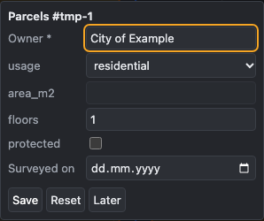
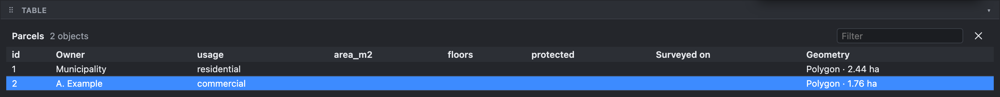

# Attributes and table

How to fill in and change the attributes of objects, and how to see a whole layer as a table.

> The screenshots show the reference layout that ships with OLAD. Your application may arrange the panels differently.

Each layer defines its own **attributes**, for example owner and usage for parcels, or name and lanes for roads. Required attributes are marked with `*`.

## The attribute popup

Right after you add an object to a layer with attributes, a popup asks for them:

- **Save** stores the values and closes the popup.
- **Reset** brings back the values the form started with.
- **Later** closes the popup and keeps the object with its default values; you can fill them in later in the Attributes panel.

The browser checks the input before saving: required fields, numbers, allowed ranges and patterns. When one action adds several objects (for example mirrored copies, or a line split by Trim), the popup shows them one after another ("1 of 3"). Imported objects and template copies open no popup.

## The Attributes panel

Open the **Attributes** panel on the right of the map. It shows the attributes of the **one selected object**:

- Change the values and click **Apply**. Only the changed values are saved, as one undo step.
- With edit mode off, or on a layer that does not allow changes, the fields are read-only. A hint says why.
- With edit mode off, clicking an object opens the panel by itself, so you can inspect attributes while just viewing.
- Draft objects have no attributes. The panel tells you to move them into a layer first (see [Drafts](Edit-Mode-and-Layers#drafts)).

## Table view

Press  **Table** on a layer's row in the Layers panel. The layer's objects appear as a table below the map:

- **Columns**: the id, every attribute, and the geometry with its length or area.
- **Sort**: click a column heading (ascending, descending, off).
- **Filter**: type in the filter field to show only rows containing the text.
- **Select**: click a row to select its object on the map; Ctrl+click (Cmd+click) adds or removes rows, Shift+click selects a range. Objects you select on the map are highlighted in the table.
- **Zoom**: double-click a row to zoom the map to its object.
- **Changes**: new and changed objects are marked until you save.

The table is read-only: edit the values in the Attributes panel, which follows the selected row. Press the Delete key to delete the selected rows. Close the table with its × button or the Table button again.

## See also

- [Edit mode and layers](Edit-Mode-and-Layers)
- [Undo and saving](Undo-and-Saving)
