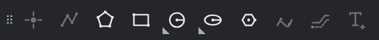
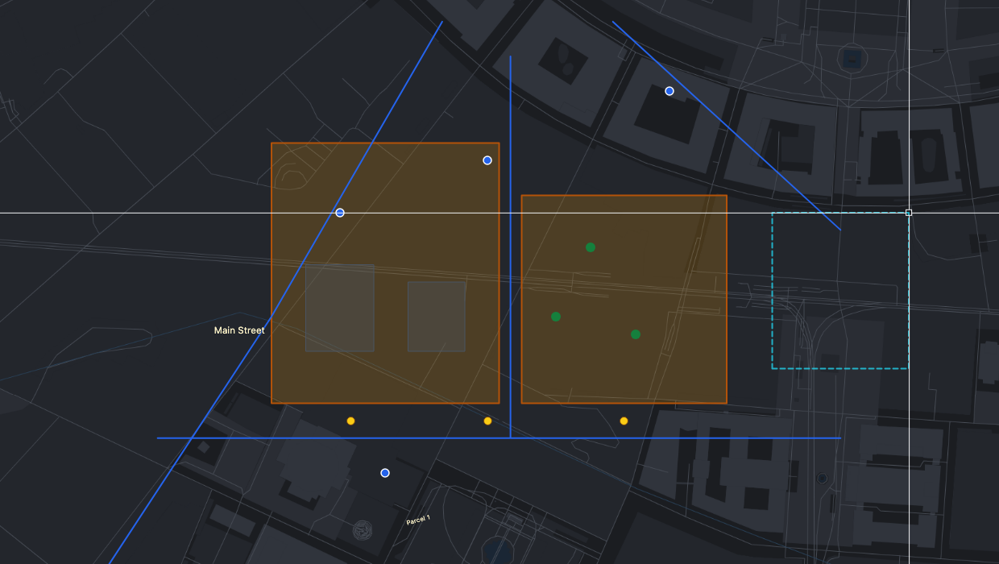
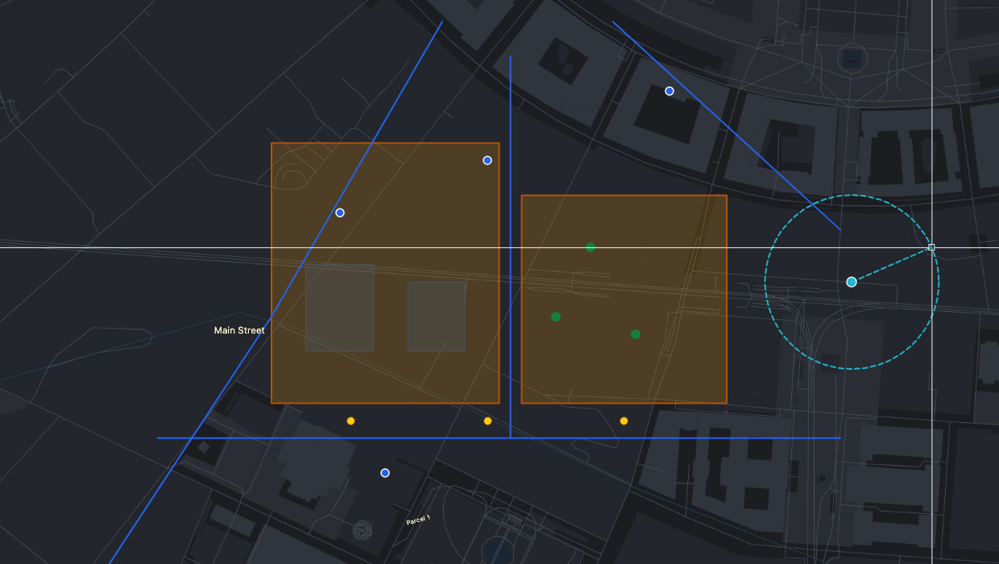
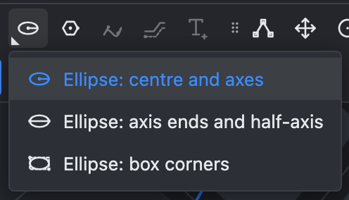
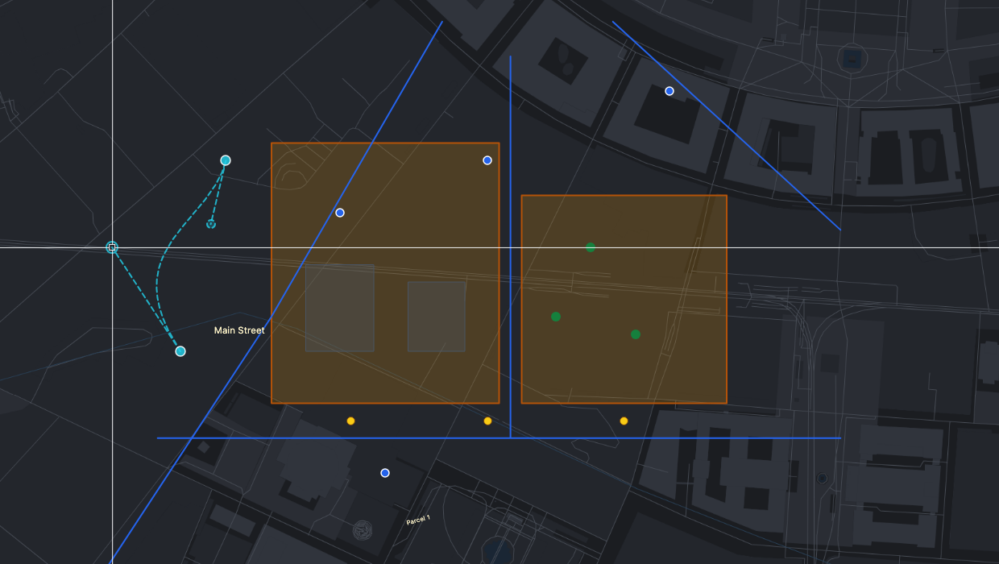
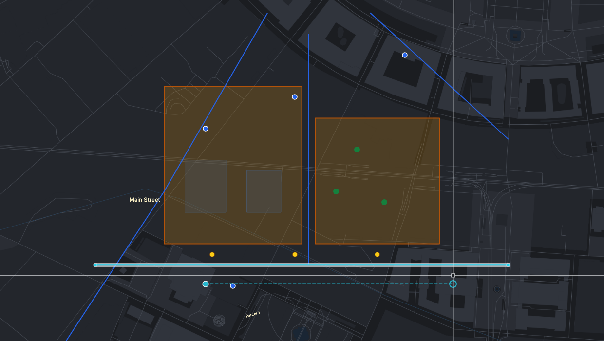

# Drawing tools

How to create new objects: points, lines, polygons, rectangles, circles, ellipses, regular polygons, curves, parallels and texts.

> The screenshots show the reference layout that ships with OLAD. Your application may arrange the toolbars differently.

## Before you draw

1. Open the **Layers** panel and press  **Edit** on the layer you want to add to. This switches edit mode on and makes the layer active. Without an active layer, new objects go into the [Draft layer](Edit-Mode-and-Layers#drafts).
2. Choose a tool from the **Draw** toolbar. Only the tools that fit the layer are enabled: polygon tools for a polygon layer, line tools for a line layer, point and text tools for a point layer. If a drawing tool is already running when you switch layers, it keeps running for the new layer (its button stays pressed) and you can start drawing right away. Pressing a pressed button switches the tool off.
3. Follow the **prompt on the command line**: it always says what the tool expects next.

Every drawing tool works the same way:

- **Click** on the map to place a point, or **type** it on the command line. Snapping, the grid and the angle lock help you place it exactly. See [Precision aids](Precision-Aids).
- **Enter** finishes, **Escape** steps back or cancels, **Backspace** removes the last point.
- The tool stays active after an object is finished, so you can draw several in a row.
- The new object is **selected**. If the layer has attributes, the [attribute form](Attributes-and-Table#the-attribute-popup) opens so you can fill them in.
- If the shape is not valid (for example a polygon whose edges cross), it is refused with a message and nothing is added.

## Draw point

Click on the map: each click places one point. You can also type `x,y` and press Enter.

## Draw line

1. Click the first point.
2. Click each further point. Instead of clicking, type a coordinate, an offset (`@10,0`), a distance and angle (`@25<90`), or just a length (`12.5`): the next point is then placed that far away in the direction of the pointer.
3. **Double-click** or press **Enter** to finish (at least two points).

## Draw polygon

Like a line: click the corners one after another, then **double-click** or press **Enter** to close the polygon (at least three corners).

## Draw rectangle

1. **First corner**: click or type `x,y`.
2. **Opposite corner**: click, or type it relative to the first corner. For example `@30,20` makes a rectangle 30 wide and 20 high.

A dashed preview follows the pointer.

The sides follow the **straightedge**: normally they run east–west and north–south. After [Align to segment](Precision-Aids#straightedge) the rectangle comes out parallel to the segment you picked, for example the edge of a building.

## Draw circle (flyout)

The circle button has three variants. Right-click it or click its triangle to choose one.

| Variant                                                                               | Steps                                                                         |
| ------------------------------------------------------------------------------------- | ----------------------------------------------------------------------------- |
|  **Centre and radius**       | Click the centre, then type the radius (`15`) or click a point on the circle. |
|  **Centre and point**   | Click the centre, then click a point the circle passes through.               |
|  **Three points** | Click three points on the circle.                                             |

Circles are stored as polygons with enough corners that they look perfectly round. Your application sets how exact they are.

## Draw ellipse (flyout)

| Variant                                                                                    | Steps                                                                                                              |
| ------------------------------------------------------------------------------------------ | ------------------------------------------------------------------------------------------------------------------ |
|  **Centre and axes**             | Click the centre, then the end of the first axis, then type the other half-axis or click a point at that distance. |
|  **Axis ends and half-axis** | Click both ends of the first axis, then type the other half-axis or click a point.                                 |
|  **Box corners**              | Click two opposite corners of a box: the ellipse fills it.                                                         |

## Draw regular polygon

A polygon with equal sides, such as a hexagon:

1. **Number of sides**: type it and press Enter, or press Enter to keep the number shown (6 at first).
2. **Centre**: click or type `x,y`.
3. **Vertex**: click a corner, or type the distance from the centre to the corners.

## Draw curve

A smooth curve whose start and end direction you control:

1. Click the **start point**.
2. Click the **end point**. The curve appears with a handle at each end.
3. **Click a handle** to pick it up and move it. The curve bends as you move. Click again to put the handle down. Repeat as often as you like.
4. Press **Enter** to add the curve.

A handle's direction is the direction the curve leaves its end, and its length controls how far the curve keeps that direction. Typing `@30<45` while a handle is picked makes the curve leave at 45°.

## Draw parallel

Draws a line at a fixed distance beside an existing line or polygon, following its bends:

1. **Click the line or polygon** to run parallel to. If one is already selected, this step is skipped.
2. **Click the start point** beside it. Its distance from the object sets the distance of the parallel.
3. **Move the crosshair along the object**: a dashed preview follows. Click to end the parallel there, or type its length.

The tool then asks for the next start point beside the same object. Escape picks a different object.

## Draw text

Places a text on the map, for example a street name or a note. It needs a text layer, or no active layer (the text then goes into the Draft layer).

1. **Insert point**: click where the text starts.
2. **Text height**: type the height of the letters on the ground (for example `2.5` for 2.5 m), or press Enter to keep the height offered.
3. **Text**: type the text and press Enter.

The text follows the straightedge angle, so it can be aligned with a road. It grows and shrinks as you zoom, like a printed map.

## See also

- [Precision aids](Precision-Aids): snapping, grid, angle lock and typed input
- [Modify tools](Modify-Tools)
- [Workflow: a parcel with exact dimensions](Workflow-Precise-Parcel)
