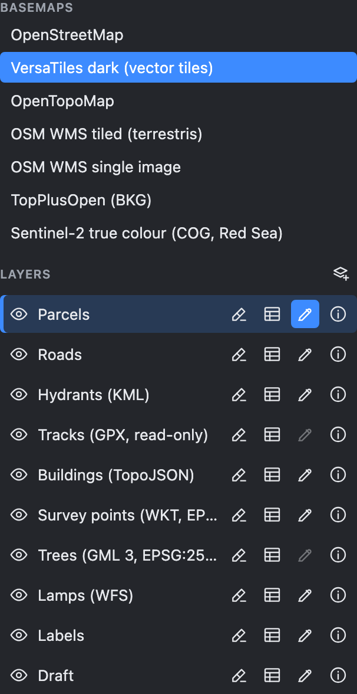
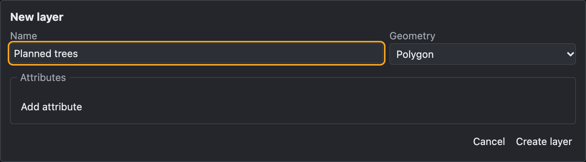
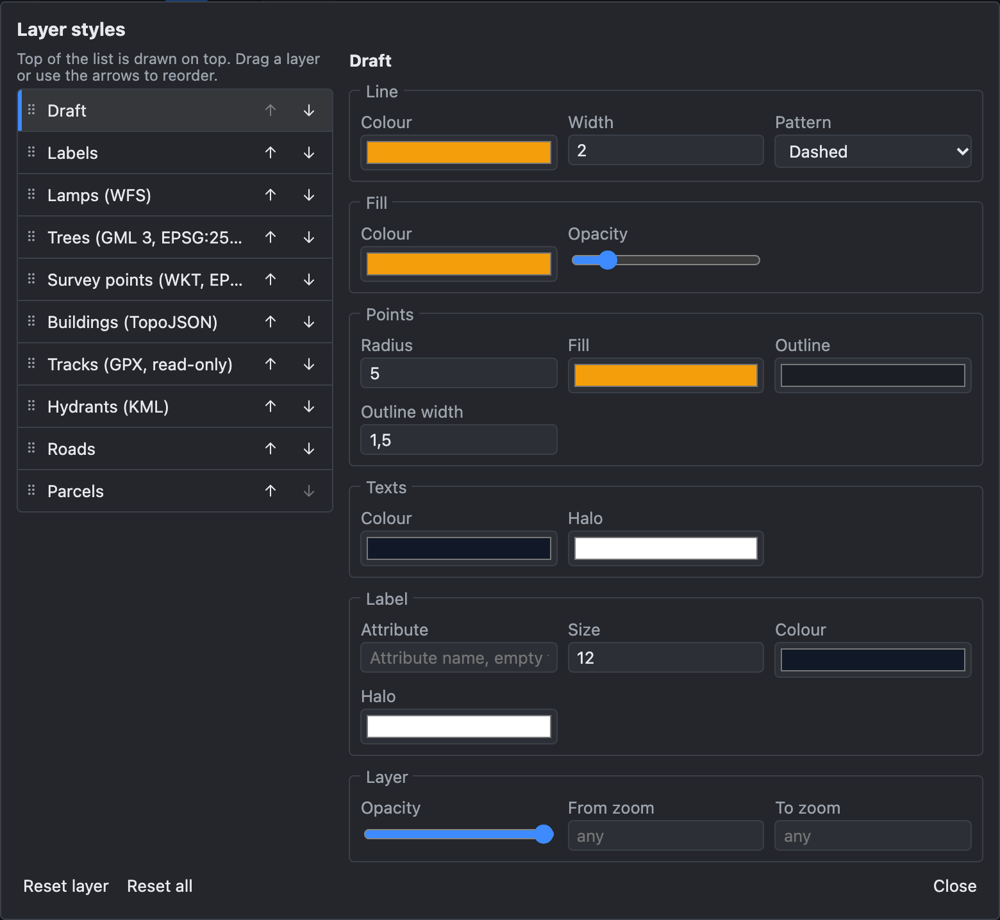

# Edit mode and layers

How to start editing, choose the layer you work on, and manage layers: visibility, details, your own local layers and their look.

> The screenshots show the reference layout that ships with OLAD. Your application may arrange the buttons differently.

## Edit mode

OLAD separates **viewing** from **editing**:

- **Edit mode off**: you can pan, zoom, click an object to see its attributes, and measure. Nothing can be changed.
- **Edit mode on**: the drawing and modify tools are available, the pointer becomes a crosshair, and snapping is active.

Switch it with the  **Edit mode** button in the main toolbar. Pressing a layer's **Edit** button (below) switches it on too.

Switching edit mode off stops the running tool. The measure tools are the exception: they keep running.

## The layer list

Open the **Layers** panel on the right of the map.

**Basemaps** at the top: click one to show it as the background; that hides the others.

The eye before each heading (**Basemaps**, **Overlays**, **Layers**) shows or hides the whole section with one click: all basemaps at once (stacked, the last one in the list on top), all overlays, or all layers. It is half-tone while only some are visible; a click then shows all.

**Layers** below: each row is one layer, for example Parcels or Roads. A layer holds one kind of object with one geometry type (points, lines or polygons) and its own attributes. The buttons on each row:

| Button                                                     | Name           | Use                                                                                                                                |
| ---------------------------------------------------------- | -------------- | ---------------------------------------------------------------------------------------------------------------------------------- |
|          | **Visible**    | Show or hide the layer.                                                                                                            |
|    | **Highlight**  | Draw every object of the layer in a strong highlight colour, to find them quickly.                                                 |
|        | **Table**      | Open the layer's objects as a table below the map. See [Attributes and table](Attributes-and-Table#table-view).                    |
|         | **Edit**       | Make this the **active layer** and switch edit mode on. Press it again to clear the active layer. If you switched edit mode off, it switches it back on and keeps the layer active. Greyed out for read-only layers. |
|  | **Move draft** | Shown only while draft objects are selected: moves them into this layer. See [Drafts](#drafts).                                    |
|     | **Settings**   | Only on your own local layers: rename, change attributes, delete.                                                                  |
|         | **Details**    | Show the geometry type, what you may do (insert, update, delete), the number of objects and more.                                  |

## The active layer

The **active layer** is where new objects go. Press **Edit** on a layer's row to make it active. Its name then appears in the main toolbar ("Layer: Parcels").

The active layer decides which drawing tools you can use: on a polygon layer you can draw polygons, rectangles, circles and ellipses, on a line layer lines, curves and parallels, on a point layer points.

### What you may change

Each layer has its own permissions, set by the application:

- **insert**: you may add new objects,
- **update**: you may change existing objects (shape and attributes),
- **delete**: you may delete objects.

A read-only layer cannot be made active, but you can still snap to it, measure it and copy its objects as templates. The **Details** button shows the permissions of each layer. If an edit is not allowed, OLAD refuses it and tells you why on the command line.

## Drafts

If you draw while **no layer is active**, the objects go into the **Draft** layer. Drafts are scratch objects:

- they have no attributes,
- they are never saved to the server,
- you can edit, snap to and delete them like any other object.

To keep a draft, select it. The layer list then shows a  **Move draft** button on every layer that can take it. Click the button on the layer you want: the draft is moved there and the attribute form opens. See the workflow [Sketch first, assign later](Workflow-Sketch-Then-Assign).

## Your own layers (local layers)

Click  **New layer** beside the Layers heading to create a layer of your own:

1. Enter a **Name**.
2. Choose the **Geometry**: point, line, polygon or their multi-part variants.
3. Add **attributes** with **Add attribute**: a name, a type (text, number, whole number, yes / no, list of values, date), an optional label, required or not, and a default.
4. Click **Create layer**.

Local layers are kept in your browser on the reference page. Other applications decide for themselves: if yours does not save them, they are lost when you reload the page. The layer's **Info** details tell you which applies: **Storage: this browser**, or **Storage: memory (lost on reload)**. They are fully editable, but their objects are **not** sent to the server when you save. Use them for notes, plans and imported data, and [export](Import-and-Export) them when you need a file. The **Settings** button on their row renames them, changes their attributes or deletes them.

## Layer styles

**View → Layer styles…** changes how layers look and in which order they are drawn:

- **Order** (left): the layer at the top of the list is drawn on top. Drag a layer, or use the arrows.
- **Style** (right) for the selected layer: line colour, width and pattern, fill colour and opacity, point size and colours, a label from an attribute, the layer's opacity and the zoom range in which it is shown.

Changes apply immediately. **Reset layer** and **Reset all** go back to the original look. On the reference page your styles are remembered in the browser.

## See also

- [User interface](User-Interface)
- [Drawing tools](Drawing-Tools)
- [Attributes and table](Attributes-and-Table)
