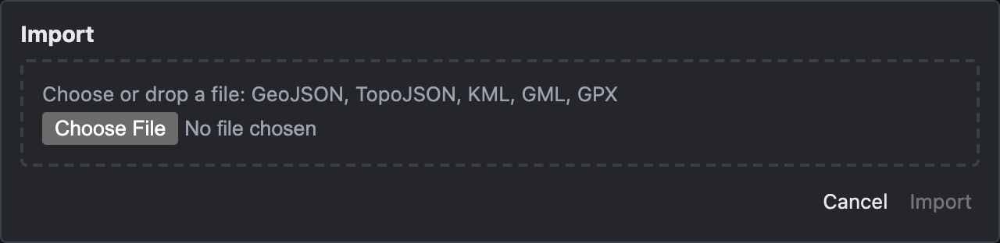
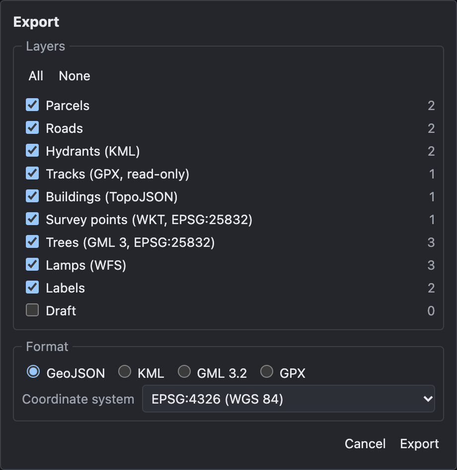

# Import and export

How to load geodata files into the map and save layers as files.

> The screenshots show the reference layout that ships with OLAD. Your application may offer these functions in another place.

## Import

**File → Import…** opens the import dialog:

1. Choose a file, or drop it onto the dialog. Supported formats: **GeoJSON**, **TopoJSON**, **KML**, **GML** (2, 3 and 3.2) and **GPX**.
2. OLAD splits the file into **groups** of one geometry type: by the file's own layers, KML folders or GML feature types, and then into points, lines and polygons. The coordinate system is taken from the file.
3. For each group choose **Import into**:
   - **New local layer** (the default): a new layer of your own, named as shown. You can change the name.
   - **Into <layer>**: an existing layer that takes this geometry type and allows adding objects.
   - **Skip**.
4. Click **Import**.

The whole import is **one undo step**. Attributes are taken over from the file, and the attribute popup stays closed. Objects with invalid geometry are left out and counted in the summary line. Height values (Z) are dropped.

Imported objects in a server layer are sent to the server with your next save. Objects in local layers stay in your browser.

## Export

**File → Export…** opens the export dialog:

1. Tick the **layers** to export (**All** / **None**). Layers with objects are ticked when the dialog opens.
2. Choose the **format**:
   - **GeoJSON**: one file with all objects; a `layer` property tells them apart.
   - **KML**: one folder per layer, always in WGS 84 (EPSG:4326).
   - **GML 3.2**: one feature type per layer.
   - **GPX**: points become waypoints, lines routes and multi-lines tracks; polygons and multi-points are left out. Always in WGS 84.
3. Choose the **coordinate system** (GeoJSON and GML).
4. Click **Export**: the file is downloaded.

Export writes the objects as they are now, including unsaved changes and drafts. It does not change any data.

## See also

- [Workflow: import, edit, export](Workflow-Import-Edit-Export)
- [Edit mode and layers](Edit-Mode-and-Layers#your-own-layers-local-layers)
