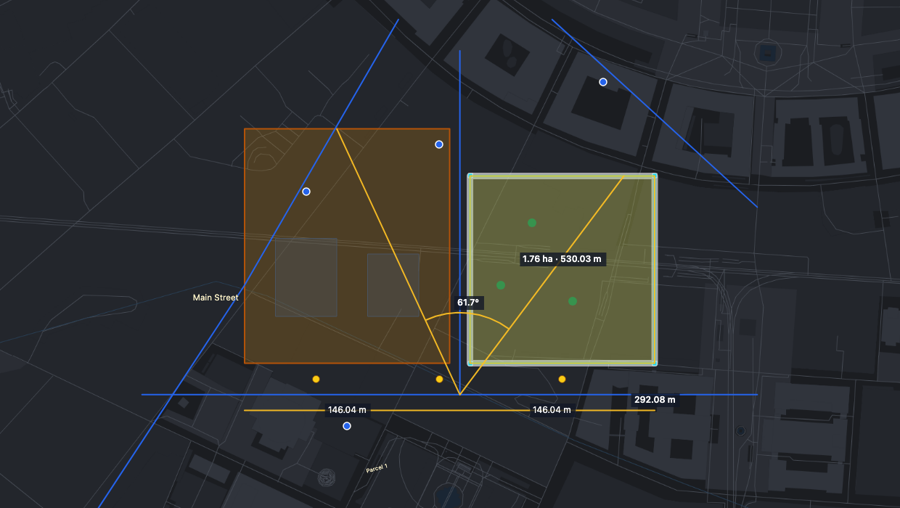
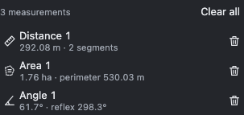

# Measuring

How to measure distances, areas and angles on the map without changing any data.

> The screenshots show the reference layout that ships with OLAD. Your application may arrange the toolbars differently.

The measure tools work **with or without edit mode**, so you can measure while just viewing. Snapping and typed points work as in edit mode.

## Measure distance

Click points along the way. Each segment shows its length, and the total is shown at the pointer. Press **Enter** to finish.

## Measure area

Click the corners of the area. The polygon shows its area and perimeter. Press **Enter** to finish (at least three corners).

## Measure angle

Click a first point, the vertex of the angle, and a second point. The angle at the vertex is shown with an arc.

## Measure an existing object

**Alt+click** a line or polygon:

- with **Measure distance**: the length of a line or the perimeter of a polygon,
- with **Measure area**: the area and perimeter of a polygon.

This works on every visible layer, read-only ones included.

## Keys

- **Backspace** removes the last point.
- **Escape** drops the measurement in progress (finished ones stay).
- The tool stays active for the next measurement.

## The Measure panel

Open the **Measure** panel on the right of the map to see all finished measurements:

- Click a measurement to zoom to it.
- The bin icon removes one, **Clear all** removes all. The  **Clear measurements** button in the toolbar does the same.

Measurements are never part of your data and are never saved to the server.

## Accuracy

Lengths and areas are true ground values in metres and square metres, also on Web Mercator maps, where OLAD corrects for the map's distortion. They are shown in the length unit of the CRS bar: m / km and m² / ha / km² for metric, ft / mi and ft² / ac / mi² for feet.

## See also

- [Precision aids](Precision-Aids)
