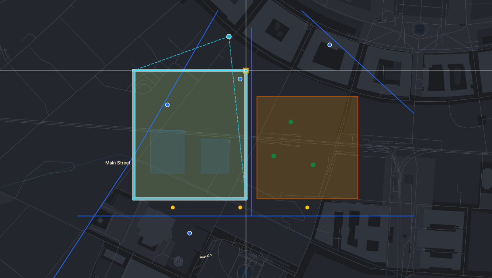
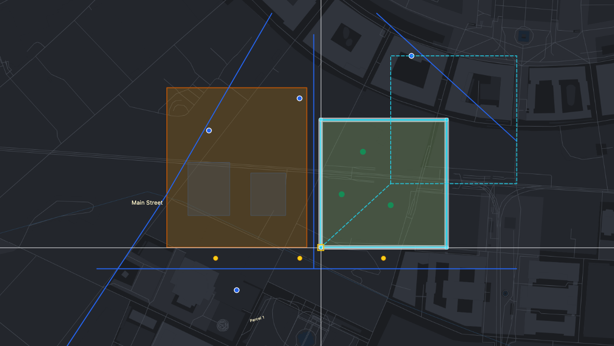
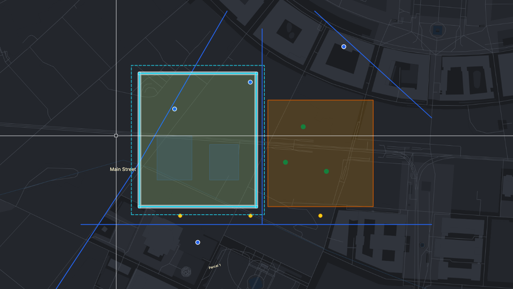
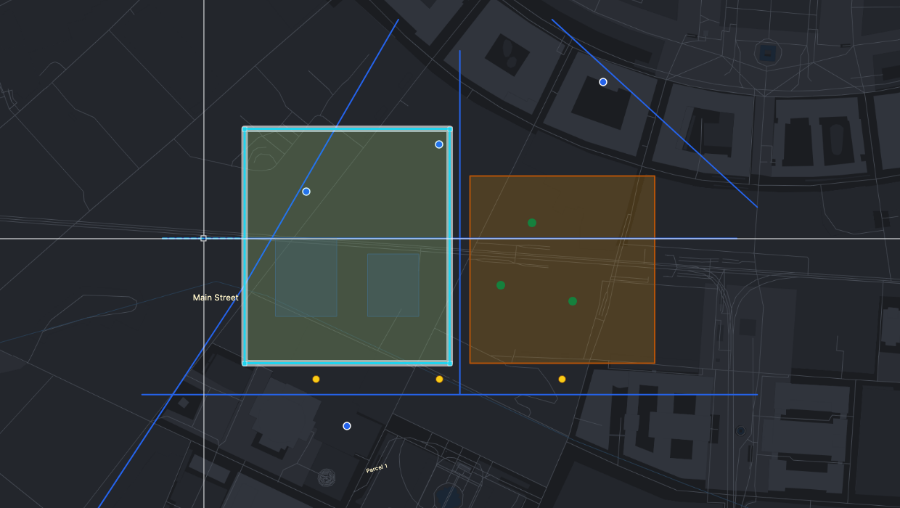
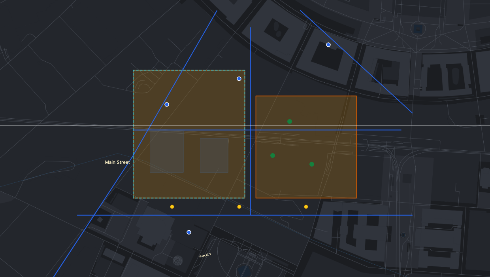

# Modify tools

How to change existing objects: select, delete, edit vertices, move, rotate, scale, mirror, offset, trim and extend.

> The screenshots show the reference layout that ships with OLAD. Your application may arrange the toolbars differently.

 

All modify tools need **edit mode** (see [Edit mode and layers](Edit-Mode-and-Layers)). They change only objects whose layer allows changes; others are skipped, and the command line says so. Each change is **one undo step**.

Most modify tools work **CAD style**: first select the objects, then give points. If something is already selected when you start the tool, the selection step is skipped.

## Select

- **Click** an object to select it; click empty map to clear the selection.
- **Shift+click** adds or removes an object.
- **Ctrl+drag** (Cmd+drag on a Mac) draws a box: everything it touches is selected.
- **Escape** clears the selection.

Selected objects are highlighted with a cyan outline and grips on their corners. The selection is kept when you switch tools.

With edit mode off you can still click an object to see its attributes. Nothing can be changed then.

## Delete

Click **Delete** in the main toolbar or press the **Delete** key: the selected objects are deleted. Objects on layers that do not allow deleting stay selected. Undo brings them back.

## Vertices

Edit the corners (vertices) of one object:

1. **Click the object**.
2. **Click a vertex** to pick it up, or click on an edge to create a new vertex there. **Alt+click** a vertex, or point at it and press **Delete**, to remove it.
3. **Click the new position**, or type it, for example `@0,5` for 5 m north of where it was. Escape puts the vertex back.

Continue with the next vertex. Press **Enter** when you are done with the object.

## Move

1. **Select the objects** and press Enter (skipped if something is selected).
2. **Base point**: click a point to move by, typically a corner. Snapping helps you hit it exactly.
3. **Second point**: click where the base point goes, or type the displacement, for example `@10,0` (10 m east) or `@5<90` (5 m north).

## Rotate

1. **Select the objects** and press Enter.
2. **Centre of rotation**: click.
3. **First point of the angle**: click a point that shows the current direction, for example another corner.
4. **Second point of the angle**: click where that direction should point. The objects turn by the angle between the two points.

To rotate by an exact angle, type the second point as a distance and angle, for example `@10<30` when the first point lay at 0°.

## Scale

1. **Select the objects** and press Enter.
2. **Base point**: the point that stays where it is.
3. **Scale factor**: type it (`2` doubles, `0.5` halves) and press Enter. Or click a **reference point**, then a **target point**: the objects grow or shrink so the reference distance becomes the target distance. Type a length as the target point (`25`) to scale the reference distance to exactly that length.

## Mirror

1. **Select the objects** and press Enter.
2. Click **two points of the mirror line**.
3. **Create a copy? [y/N]**: press **Enter** to mirror the objects in place, or type **y** to keep them and add mirrored copies.

## Offset

Makes a parallel copy of a line or polygon at a typed distance, for example a building setback line:

1. **Click the line or polygon.**
2. **Distance**: type it, for example `10`. Next time, Enter keeps the last distance.
3. **Side**: click on the side the copy goes to. For a polygon, inside makes it smaller and outside larger.

The copy is selected and becomes the next source, so clicking again makes the next parallel at the same distance.

## Trim

Cuts lines back to a boundary:

1. **Select the boundary**: click a line or polygon. It is never changed.
2. **Click the part of a line to remove.** The piece up to the boundary disappears. A dashed preview shows which piece will go. Repeat for as many lines as you like.
3. Press **Enter** or **Escape** to choose a different boundary.

| Before: the part left of the parcel is previewed | After                                    |
| ------------------------------------------------ | ---------------------------------------- |
|        |  |

If you remove a piece from the middle of a line, the line is split into two objects.

## Extend

Lengthens lines up to a boundary:

1. **Select the boundary**: click a line or polygon.
2. **Click a line near the end to extend.** That end grows in its own direction until it meets the boundary.
3. Press **Enter** or **Escape** to choose a different boundary.

## Copy to template

Stores objects as a template that you can place again and again. See [Templates](Templates).

## See also

- [Precision aids](Precision-Aids)
- [Undo and saving](Undo-and-Saving)
- [Workflow: correcting roads](Workflow-Road-Corrections)
