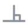
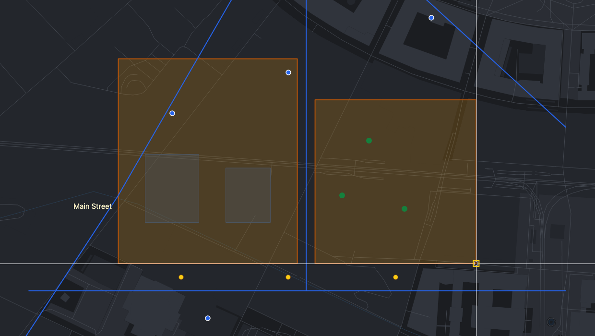
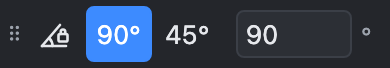

# Precision aids

How to place points exactly: snapping, the grid, the straightedge, the angle lock and typed coordinates and lengths.

> The screenshots show the reference layout that ships with OLAD. Your application may arrange the toolbars differently.

These aids work with **every** tool that asks for a point: drawing, moving, rotating, measuring and so on.

## Snapping

With snapping on, the crosshair **jumps** to a nearby point of an existing object when you get close. A small marker shows what it snapped to. Your click then lands exactly there.

| Control                                                                            | Use                                                                                                                         |
| ---------------------------------------------------------------------------------- | --------------------------------------------------------------------------------------------------------------------------- |
|  **Snap**                       | Turn snapping on or off.                                                                                                    |
| **Radius** (px)                                                                    | How close, in screen pixels, the pointer must come before it snaps.                                                         |
|  **Points**               | Snap to corners of lines and polygons, and to point objects. Marker: a square.                                              |
|  **Midpoints**          | Snap to the middle of an edge. Marker: a triangle.                                                                          |
|  **Perpendicular** | While drawing: snap to the point on an edge where your new segment meets it at a right angle. Marker: a right-angle symbol. |
|  **Tangent**             | While drawing: snap to the point where your new segment just touches a circle or curve. Off by default.                     |

You can snap to every visible layer that allows it, including read-only layers. Snapping is active in edit mode and while measuring.

## Grid

| Control                                                           | Use                                                                                           |
| ----------------------------------------------------------------- | --------------------------------------------------------------------------------------------- |
|  **Grid snap** | Turn grid snapping on or off. With it on, every point lands on the nearest grid intersection. |
| **Spacing**                                                       | The distance between grid lines, in the unit of the map's coordinate system (usually metres). |
|  **Show grid**  | Draw the grid as dots while edit mode is on.                                                  |

Snapping to an object wins over the grid, so corners of existing objects are still hit exactly.

## Straightedge

In edit mode the pointer is a **crosshair**, like the straightedge on a drawing board. Its angle is the reference direction for:

- rectangles and box-shaped ellipses (their sides follow it),
- the angle lock (below),
- typed angles (`@25<90` means 90° from the straightedge),
- the angle of new texts.

| Control                                                                          | Use                                                                                                                                                  |
| -------------------------------------------------------------------------------- | ---------------------------------------------------------------------------------------------------------------------------------------------------- |
| **Angle**                                                                        | Type an angle in degrees and press Enter. 0° is east–west.                                                                                           |
|  **Reset**                   | Back to 0°.                                                                                                                                          |
|  **Align to segment** | Then click an edge of a line or polygon on the map: the straightedge takes its direction. The edge under the pointer is highlighted. Escape cancels. |

Example: to draw a garage parallel to a crooked house, align the straightedge to the house wall, then draw the rectangle.

## Angle lock

With the angle lock on, new segments can only run in fixed directions: multiples of the **step** from the straightedge angle.

| Control                                                                 | Use                                                                              |
| ----------------------------------------------------------------------- | -------------------------------------------------------------------------------- |
|  **Lock angle** | Turn the lock on or off.                                                         |
| **90°** / **45°**                                                       | Common steps: 90° gives the four right-angle directions, 45° adds the diagonals. |
| **Step**                                                                | Any other step in degrees, for example 30.                                       |

The first point is free; the lock applies from the second point on. Snapping to an object wins over the lock, so a locked line can still end exactly on a corner.

## Typing coordinates and lengths

Instead of clicking, type on the command line and press **Enter**:

| You type    | Meaning                                                                                                                                                                                  |
| ----------- | ---------------------------------------------------------------------------------------------------------------------------------------------------------------------------------------- |
| `2500,1200` | An **absolute** coordinate in the map's coordinate system.                                                                                                                               |
| `@10,5`     | 10 east and 5 north of the **last point**.                                                                                                                                               |
| `@25<90`    | 25 from the last point at **90°** (counter-clockwise from the straightedge, so north when the straightedge is at 0°).                                                                    |
| `12.5`      | 12.5 from the last point **in the direction of the pointer**. Point the mouse in the direction, then type the length. With the angle lock on, the direction snaps to the allowed angles. |

Some steps ask for a value instead of a point, for example the number of sides of a polygon, a radius, an offset distance or a scale factor. Then just type the number.

### Units

Lengths are in the **length unit** chosen in the CRS bar (Auto: usually metres). You can always add a unit:

`12.5 m`, `40 ft`, `3'`, `250 cm`, `1.2 km`, `@3ft,4ft`, `@10 mi<45`

Known units: `m`, `km`, `cm`, `mm`, `ft` (also `'`), `us-ft`, `in` (also `"`), `yd`, `mi`, `nmi`. Absolute coordinates (`x,y`) never take a unit.

### Exact lengths on a Web Mercator map

Web maps usually use the Web Mercator projection, where map units are not real metres. OLAD corrects for this: a typed `10` is 10 real metres on the ground, and measurements show true lengths.

## Coordinate system

The **projection** select in the CRS bar switches the map's coordinate system, for example to a national grid such as UTM. Absolute coordinates you type are in the selected system, and the grid aligns with it. Any drawing in progress is cancelled when you switch.

## See also

- [Drawing tools](Drawing-Tools)
- [Measuring](Measuring)
- [Keyboard shortcuts](Keyboard-Shortcuts)
