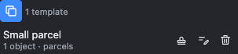
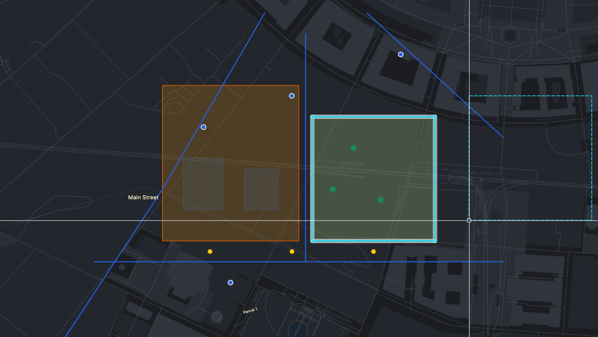

# Templates

How to store objects as a reusable template and place copies of them anywhere, as often as you need.

> The screenshots show the reference layout that ships with OLAD. Your application may arrange the toolbars and panels differently.

A template is a named copy of one or more objects, for example a standard garage, a hydrant with its valve, or a typical junction. It keeps the shapes and the attributes. Copying into a template changes no data.

## Create a template

1. Select the objects (see [Select](Modify-Tools#select)).
2. Click  **Copy to template** in the Modify toolbar, or the same button at the top of the **Templates** panel.
3. **Base point**: click the point by which the copies will be placed, for example a corner. Snapping helps you hit it.
4. **Template name**: type a name and press Enter, or press Enter to keep the suggested one.

Objects from read-only layers can be copied too.

## Insert copies

Open the **Templates** panel on the right of the map:

1. Click  **Insert** on a template. A dashed preview of it hangs at the crosshair by its base point.
2. **Click** where the copy goes, or type `x,y`, or `@dx,dy` relative to the last copy. Each click places one copy.
3. Press **Escape** or **Enter** when you are done.

Each copy goes into the layer its original came from, if you may add objects there. Otherwise it goes into the active layer, otherwise into the Draft layer. Copies keep their attributes.

## Manage templates

-  **Rename**: type the new name and press Enter.
-  **Remove**: deletes the template, not the objects.

On the reference page templates are kept in your browser; your application may store them differently.

## See also

- [Modify tools](Modify-Tools)
- [Edit mode and layers](Edit-Mode-and-Layers)
