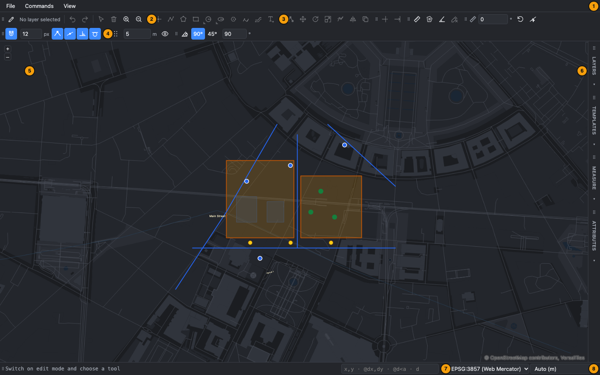
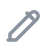
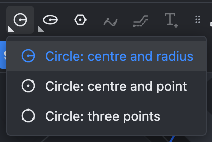
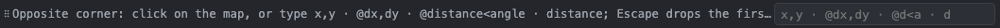
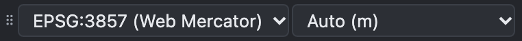

# User interface

A tour of the OLAD screen: where the tools are, where you type, and how to rearrange the workspace.

> The screenshots show the full reference layout that ships with OLAD. Your application may place toolbars and panels differently or leave some out; the tools work the same everywhere.

| #   | Area               | What it is for                                                                                                                     |
| --- | ------------------ | ---------------------------------------------------------------------------------------------------------------------------------- |
| 1   | **Menu bar**       | File (save, discard, import, export), View (layer styles, theme, show / hide toolbars and panels).                                 |
| 2   | **Main toolbar**   | Edit mode, the active layer, Undo / Redo, Select, Delete, zoom.                                                                    |
| 3   | **Tool toolbars**  | Draw, Modify, Trim / Extend and Measure. See [Drawing tools](Drawing-Tools), [Modify tools](Modify-Tools), [Measuring](Measuring). |
| 4   | **Precision aids** | Snapping, grid, angle lock and straightedge. See [Precision aids](Precision-Aids).                                                 |
| 5   | **Map**            | Where you click, draw and select. In edit mode the pointer becomes a crosshair.                                                    |
| 6   | **Side panels**    | Layers, Templates, Measure and Attributes. Click a tab to open it, click it again to close it.                                     |
| 7   | **Command line**   | Shows what the current tool expects next, and takes typed coordinates, lengths and text.                                           |
| 8   | **CRS bar**        | The coordinate system of the map and the default length unit.                                                                      |

## Toolbars

The **Main** toolbar holds the controls you need all the time:

| Button                                                                                                       | Name              | Use                                                                                                               |
| ------------------------------------------------------------------------------------------------------------ | ----------------- | ----------------------------------------------------------------------------------------------------------------- |
|                                                           | **Edit mode**     | Switches editing on and off. Most tools only work in edit mode. See [Edit mode and layers](Edit-Mode-and-Layers). |
|                                                                                                              | **Layer: …**      | Shows the active layer, the one new objects go into.                                                              |
|        | **Undo / Redo**   | Step back and forward through your changes (Ctrl+Z, Shift+Ctrl+Z).                                                |
|                                                         | **Select**        | Pick objects. See [Modify tools](Modify-Tools#select).                                                            |
|                                                         | **Delete**        | Deletes the selected objects (also the Delete key).                                                               |
|   | **Zoom in / out** | Zoom the map.                                                                                                     |

Hover over any button to see a tooltip with its name and a short instruction. Buttons that cannot be used right now are greyed out: for example the Draw line button while a polygon layer is active.

### Flyout buttons

A button with a small triangle in its corner holds several variants of one tool, such as the three ways to draw a circle. Right-click the button, press and hold it, or click the triangle to choose a variant. The button then shows the variant you chose last, and a normal click starts it.

### Moving, docking and hiding

Every toolbar and panel has a grip (⠿) at its start. Drag the grip to move it:

- Drop it near an edge of the window (top, right, bottom or left) to dock it there.
- Drop it anywhere else to leave it floating over the map.
- Click the grip without dragging to open a menu with the same positions, so you can do this with the keyboard too.

Use **View → Show all toolbars and panels / Hide all toolbars and panels** or the checkbox per toolbar or panel to show and hide them. Your layout is remembered in the browser; **View → Reset layout** restores the original one.

## Side panels

The side panels open as overlays on the right of the map, so the map keeps its size:

- **Layers**: basemaps and layers, with buttons to show, highlight, edit and inspect each layer. See [Edit mode and layers](Edit-Mode-and-Layers).
- **Templates**: stored groups of objects you can place again. See [Templates](Templates).
- **Measure**: the list of your measurements. See [Measuring](Measuring).
- **Attributes**: the attributes of the selected object. See [Attributes and table](Attributes-and-Table).

Only one side panel is open at a time. A panel stays open while you work on the map; close it with its tab or Escape.

## Command line

The left part shows the **prompt**: what the current tool expects next, for example "Opposite corner: click on the map, or type x,y …". It also echoes what you typed and shows messages such as why an edit was refused.

The right part is the **input field**. You can type here instead of clicking:

- a coordinate (`2500,1200`), an offset (`@10,5`), a distance and angle (`@25<90`) or a plain length (`12.5`, `40 ft`);
- a value when the tool asks for one, such as the number of sides of a polygon;
- text when the tool asks for it, such as a label or a template name.

When a step expects typing, the field is focused and highlighted, so you can start typing right away. Press **Enter** on an empty field to finish the current tool, and **Escape** to cancel. All input forms are explained in [Precision aids](Precision-Aids#typing-coordinates-and-lengths).

## CRS bar

- **Projection**: the coordinate system of the map. Switching it redraws the map; coordinates you type are in this system.
- **Length unit**: the unit of lengths you type without a unit and of displayed lengths and areas. **Auto** follows the projection (metres for most systems).

## Light and dark theme

OLAD starts with a dark CAD-style theme. **View → Light theme** switches to a light one.

## See also

- [Keyboard shortcuts](Keyboard-Shortcuts)
- [Edit mode and layers](Edit-Mode-and-Layers)
