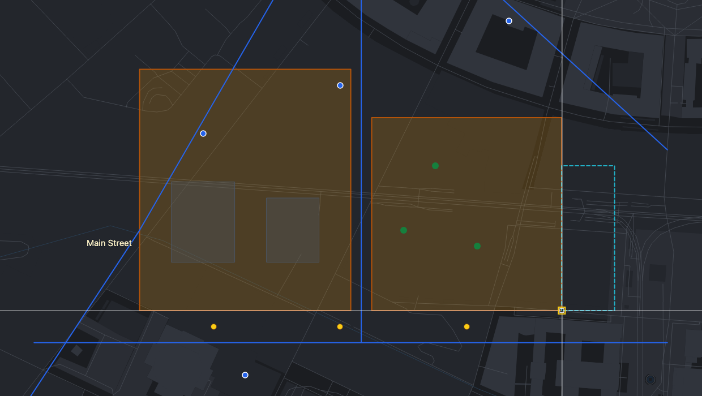
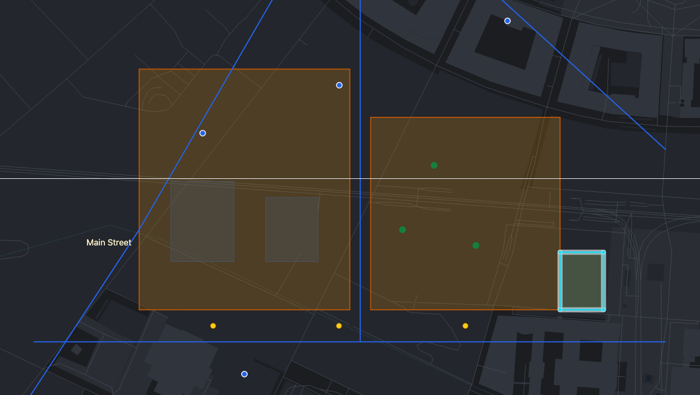

# Workflow: a parcel with exact dimensions

Draw a new 30 × 40 m parcel that starts exactly at the corner of a neighbouring parcel, fill in its attributes and save it.

> The screenshots show the reference layout that ships with OLAD. Your application may arrange toolbars and panels differently.

**You will use:** the layer list, [Draw rectangle](Drawing-Tools#draw-rectangle), [snapping](Precision-Aids#snapping), [typed offsets](Precision-Aids#typing-coordinates-and-lengths), the [attribute popup](Attributes-and-Table#the-attribute-popup).

## 1. Make Parcels the active layer

Open the **Layers** panel and press  **Edit** on **Parcels**. Edit mode switches on and the main toolbar shows "Layer: Parcels". Close the panel.

Check that  **Snap** is on and **Points** is ticked in the snap toolbox.

## 2. Start the rectangle at the neighbour's corner

Click  **Draw rectangle**. Move the crosshair close to the south-east corner of the neighbouring parcel. It jumps onto the corner, and a square marker appears:

Click. The first corner now sits exactly on the neighbour's corner.

## 3. Type the size

A dashed rectangle follows the pointer, and the command line asks for the opposite corner:

Type `@30,40` and press **Enter**: the opposite corner is 30 m east and 40 m north of the first. On a Web Mercator map these are real metres on the ground.

## 4. Fill in the attributes

The attribute popup opens for the new parcel:

Enter the **Owner** (required, marked `*`), choose the **usage** and click **Save**.

## 5. Check and save

- Made a mistake? Press **Ctrl+Z** to undo and try again.
- Choose **File → Save** to send the new parcel to the server. If saving fails, the parcel stays pending and you can try again. See [Undo and saving](Undo-and-Saving).

## Variations

- **A parcel along a crooked boundary**: click  **Align to segment** in the straightedge toolbox and click the boundary first. The rectangle then follows its direction. See [Straightedge](Precision-Aids#straightedge).
- **An irregular parcel**: use **Draw polygon** and type each corner as `@distance<angle`, for example `@25<0`, `@18<90`, `@25<180`, then **Enter**.
