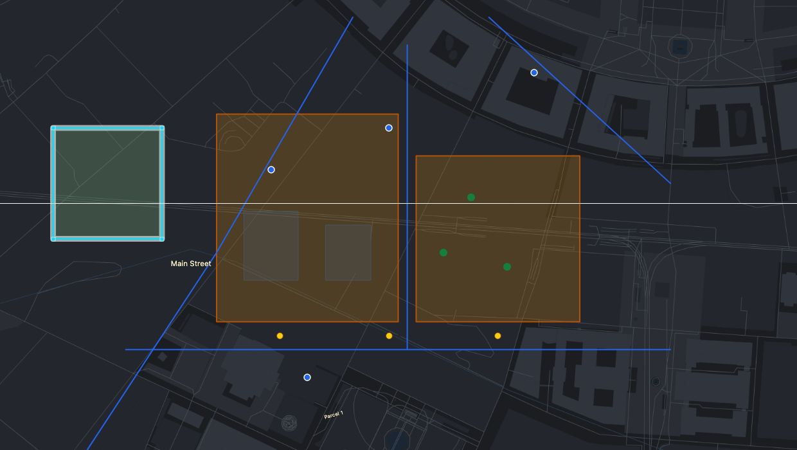
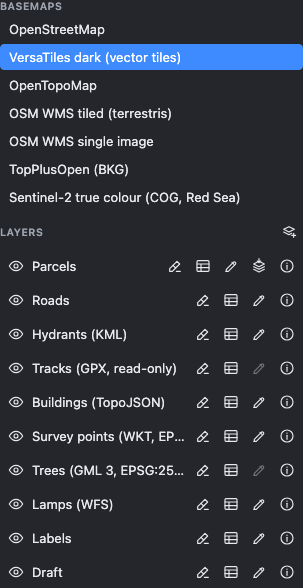

# Workflow: sketch first, assign later

Draw freely without choosing a layer, then decide which layer each shape belongs to.

> The screenshots show the reference layout that ships with OLAD. Your application may arrange toolbars and panels differently.

**You will use:** [drafts](Edit-Mode-and-Layers#drafts), the [drawing tools](Drawing-Tools), the layer list, the [attribute popup](Attributes-and-Table#the-attribute-popup).

## 1. Sketch in the Draft layer

1. Switch  **Edit mode** on, but do not press Edit on a layer. If a layer is active, press its Edit button again to clear it. The main toolbar shows "No layer selected".
2. Draw with any tool:  polygons,  lines,  points, rectangles, circles, texts…

The shapes go into the **Draft** layer. They have no attributes, no popup interrupts you, and they are never sent to the server. You can move, rotate, trim and snap to them like any other object.

## 2. Move a draft into a layer

1. **Select** the draft, or several drafts with Shift+click. The **Layers** panel opens.
2. Every layer that can take the selected shapes now shows a  **Move draft** button: a polygon fits the Parcels layer, but not Roads.

3. Click **Move draft** on the layer you want. The draft is moved into it, as one undo step.
4. The attribute popup opens for the moved object. Fill it in and click **Save**.

## 3. Save

**File → Save** sends the moved objects to the server like any newly drawn ones. Drafts you did not move stay in the Draft layer; delete them when you no longer need them.
